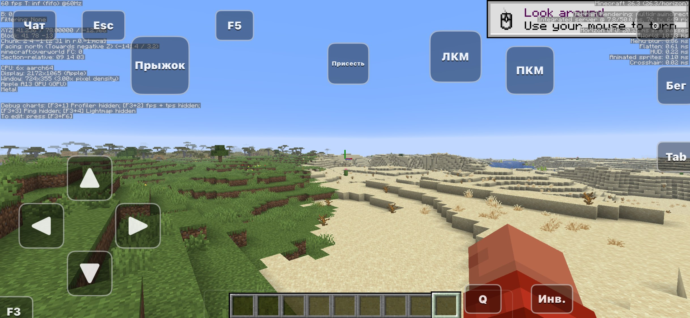
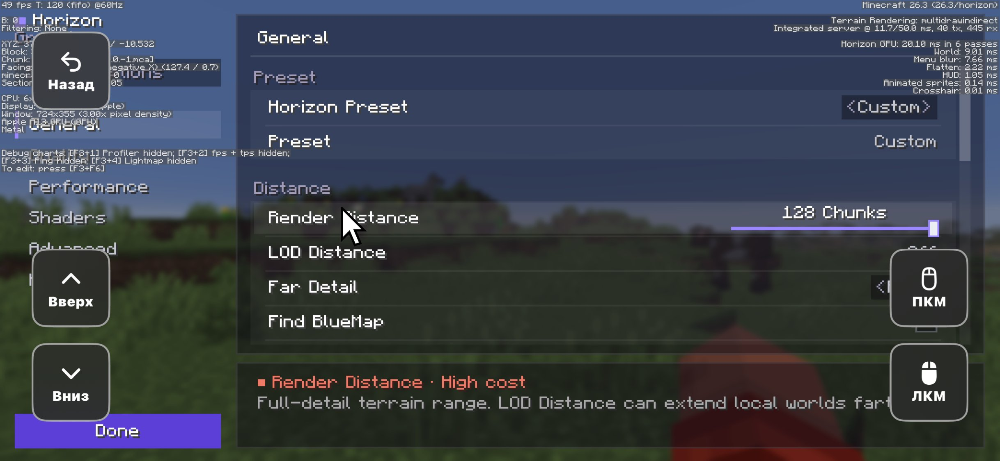

<h1 align="center">Horizon для iOS</h1>

<p align="center">
  <b>Minecraft: Java Edition 26.3, переписанный на Rust, теперь на iPhone.</b><br>
  Неофициальный порт <a href="https://github.com/horizon-rust/horizon">Horizon</a> с нативным лаунчером и сенсорным управлением.
</p>

<p align="center">
  <a href="https://github.com/neosay-dev/horizon-ios/releases/latest"><b>Скачать</b></a> ·
  <a href="#установка"><b>Установка</b></a> ·
  <a href="ios/README.md"><b>Как устроено</b></a> ·
  <a href="https://github.com/neosay-dev/horizon-ios/issues"><b>Сообщить об ошибке</b></a> ·
  <a href="#english"><b>English</b></a>
</p>

<p align="center">
  <a href="https://github.com/neosay-dev/horizon-ios/releases/latest"></a>
  
  <a href="https://github.com/neosay-dev/horizon-ios/actions/workflows/ios.yml"></a>
</p>

<p align="center">
  
</p>

## Что умеет

- **Настоящий Java Edition 26.3.** Выживание, творчество, генерация мира, мобы, редстоун и команды как в Java, без Java-машины. Миры с ПК открываются как есть.
- **Нативный лаунчер на SwiftUI.** Liquid Glass на iOS 26, вход по нику (локально) или через Microsoft, импорт файлов игры, настройки.
- **Сенсорное управление.** Крестовина или стик, кнопки прыжка, атаки, использования, бега и приседания. Раскладку можно менять в редакторе: двигать, менять размер и прозрачность, добавлять свои кнопки на любую клавишу.
- **Виртуальная мышь** для меню, инвентаря и сундуков: курсор как на трекпаде, ЛКМ, ПКМ и колёсико.
- **Шустро.** 60 fps на iPhone с A13 при дальности прорисовки 128 чанков.
- **Бережно к миру.** При сворачивании игра встаёт на паузу и сохраняется. При нехватке памяти сама снижает дальность, чтобы iOS не закрыла игру.
- **Мультиплеер.** Серверы и LAN-миры в локальной сети.

<p align="center">
  
</p>

## Установка

1. Скачай `Horizon-<версия>.ipa` из [последнего релиза](https://github.com/neosay-dev/horizon-ios/releases/latest).
2. Поставь его через AltStore, SideStore, Sideloadly или TrollStore. Нужен iOS 17 или новее.
3. Игре нужны файлы из **твоей** копии Minecraft: Java Edition 26.3 (их готовит `horizon-prepare` на ПК). Импортируй папку в лаунчере (раздел «Файлы») или скопируй её в `Documents/resources/26.3` через Finder.

Подробнее о входе, управлении и сборке: [ios/README.md](ios/README.md).

## Сборка

GitHub Actions: **Actions → iOS → Run workflow**. Получится `Horizon-unsigned.ipa` в артефактах. Если в поле **release** указать версию, CI сам выложит релиз с описанием из [`ios/RELEASE_NOTES.md`](ios/RELEASE_NOTES.md).

На Mac:

```sh
ios/build-rust.sh
cd ios && xcodegen generate && open Horizon.xcodeproj
```

## Пока не готово

- Геймпады на iOS.
- Discord, друзья и другие онлайн-дополнения Horizon.
- Выход из игры закрывает приложение: вернуться в лаунчер без перезапуска нельзя.

## English

**Horizon for iOS** is an unofficial iPhone port of [Horizon](https://github.com/horizon-rust/horizon), Minecraft: Java Edition 26.3 rewritten in Rust. It adds a native SwiftUI launcher, touch controls with a layout editor, and a virtual mouse for menus. Download the IPA from [Releases](https://github.com/neosay-dev/horizon-ios/releases/latest) and sideload it (iOS 17+). You need the game files prepared from your own copy of Java Edition. Details: [ios/README.md](ios/README.md).

## Благодарности и лицензия

Игра — это [Horizon](https://github.com/horizon-rust/horizon) от его авторов, лицензия MIT ([LICENSE](LICENSE)). Порт на iOS сделал [neosay-dev](https://github.com/neosay-dev).

Проект не связан с Mojang и Microsoft. Minecraft — их товарный знак, играть нужно со своей копией Java Edition ([EULA](https://www.minecraft.net/en-us/eula)).
